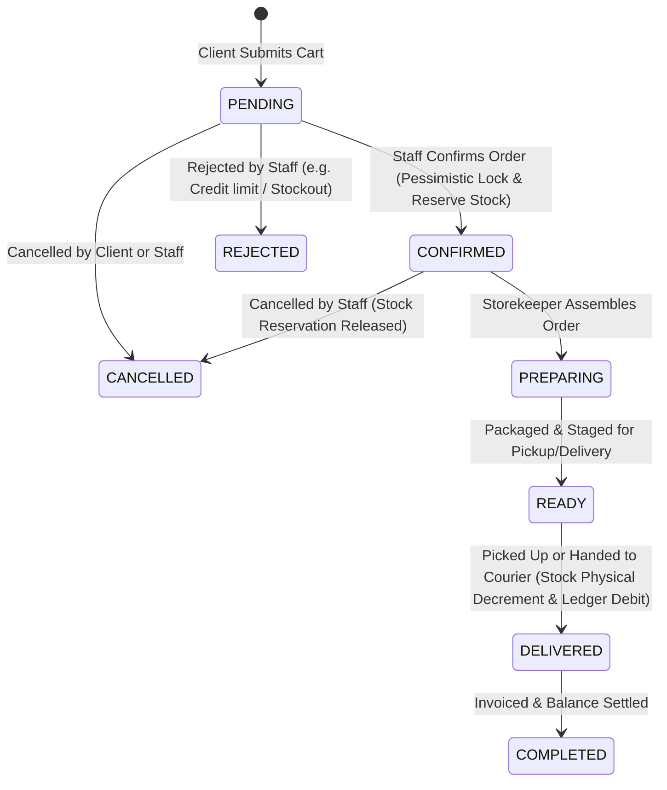

# Single-Store Mini ERP & B2B Online Shop
## Product Specification & Architecture Blueprint

> **System Version:** 1.0.0 (Foundation Blueprint)  
> **Target Market:** Industrial Equipment & Hardware Distribution (Algeria: DZD, TVA 19%, Timbre Fiscal, Commercial ID numbers RC/NIF/NIS/ART)  
> **Core Architecture:** Single-Store Monorepo (Node.js 20 / Express / TypeScript / PostgreSQL + Vue 3 / Pinia / Vite)  
> **Design Language:** Architectural Monochromatic Theme (`#171717`, `#f3f3f3`, `#ffffff`) with Print-Optimized Layouts

---

## 1. Executive Summary & Business Topology

### 1.1 Context & Comparison with Multi-Warehouse System

| Architectural Domain | Previous System (Multi-Warehouse) | New System (Single-Store ERP + B2B Shop) |
| :--- | :--- | :--- |
| **Physical Topology** | Hub-and-Spoke (Multiple regional depots) | **Single Physical Store & Central Stockroom** |
| **Data Scoping** | `warehouse_id` on all operational tables | **Removed** (Single inventory, simplified schema) |
| **Logistics Engine** | Inter-warehouse transfers, cross-depot split fulfillment | **Direct fulfillment** (Store pickup or courier delivery) |
| **User Personas** | ADMIN, SUPER_MANAGER, MANAGER, ACCOUNTANT | **ADMIN, ACCOUNTANT, CLIENT** (+ anonymous visitors) |
| **Client Onboarding** | Staff creates client records manually | **Self-Registration** with mandatory Admin review/approval |
| **Catalog Visibility** | Internal ERP POS only | **Dual Mode:** Public showcase (no prices) + Authenticated B2B Portal (prices & ordering) |
| **Ordering Model** | Counter Point of Sale (POS) | **Online B2B Shopping Cart & Checkout** + Staff counter order entry |
| **Core Retained Engine** | Pessimistic locking, immutable ledger, Algerian Factures, HR, Payroll, Expenses | **100% retained & streamlined for single-store operations** |

---

### 1.2 User Personas & Permissions

```
                                  ┌──────────────────┐
                                  │ Anonymous Visitor│
                                  └────────┬─────────┘
                                           │ Browse Public Catalog (No Prices)
                                           ▼
                                  ┌──────────────────┐
                                  │   Registration   │
                                  └────────┬─────────┘
                                           │ Submits company info & documents
                                           ▼
                                  ┌──────────────────┐
                                  │  PENDING Account │  (Cannot view prices or place orders)
                                  └────────┬─────────┘
                                           │
                    ┌──────────────────────┴──────────────────────┐
                    ▼                                             ▼
          ┌───────────────────┐                         ┌───────────────────┐
          │  Admin Rejection  │                         │   Admin Approval  │
          └───────────────────┘                         └─────────┬─────────┘
                                                                  │ Status = ACTIVE
                                                                  ▼
                                                        ┌───────────────────┐
                                                        │   ACTIVE CLIENT   │
                                                        └─────────┬─────────┘
                                                                  ├─ View Wholesale Prices
                                                                  ├─ Add to Cart & Checkout
                                                                  ├─ Track Order Pipeline
                                                                  └─ View Account Ledger & Invoices
```

#### Detailed Role Breakdown:

1. **Anonymous Visitor (`VISITOR`):**
   - Can access the public storefront.
   - Can view category trees, product names, references/SKUs, brands, technical specs, and high-resolution photo galleries.
   - **Zero price visibility.** All unit prices, taxes, and margins are stripped at the API level.
   - Cannot add items to a cart. Can only click "Register / Log In to view prices & order".

2. **Registered Client (`CLIENT`):**
   - **`PENDING`:** Waiting for admin review. When logged in, sees an explanatory status banner ("Account Pending Verification"). Still cannot see prices or place orders.
   - **`ACTIVE`:** Approved by Admin. Receives a formal client reference code (`CLT-0042`). Can view wholesale catalog prices, add to cart, choose fulfillment (`PICKUP` at store or `DELIVERY`), place orders, follow order milestones in real time, view own balance (*Solde*), download statements (*Extrait de Compte*), and download official tax invoices (*Factures*).
   - **`SUSPENDED` / `REJECTED`:** Cannot place new orders; explanatory notice displayed.

3. **Accountant (`ACCOUNTANT`):**
   - Operations specialist: reviews and confirms orders, generates delivery slips (*Bons de Livraison*) and legal tax invoices (*Factures* with Timbre Fiscal), registers customer payments (*Versements*), manages client accounts and reconciles credit ledger.
   - Can create manual sales/orders on behalf of walk-in or telephone clients.
   - Can view stock levels and perform stock adjustments with mandatory justifications.
   - **Strict Restriction:** Strictly prohibited from viewing product purchase costs (`purchase_price`) or company gross margin figures. Cannot access HR, payroll, operating expenses, or annual P&L statements.

4. **Administrator (`ADMIN`):**
   - Unrestricted system owner.
   - Reviews and approves/rejects new client applications; sets client credit limits (`credit_limit`).
   - Manages product catalog, image uploads, sale and purchase prices, and categories.
   - Full access to operational expenses, employee registry, monthly payroll with Eid/holiday bonuses, financial income statements (P&L), system settings, and immutable audit logs.

---

## 2. Core Business Processes & State Machines

### 2.1 Client Onboarding & Verification Flow

1. **Self-Service Registration:**
   - Client fills out registration form: Company Name / Trade Name, Contact Person, Phone, Email, Password, Physical Address, Wilaya, and optional Commercial Registry data (RC, NIF, ART, NIS, Activity).
   - Client can optionally upload image or PDF scans of their commercial registry (*Registre de Commerce*) and tax card (*Carte Fiscale*).
2. **Account Created in `PENDING` Status:**
   - In-app notification and email alert dispatched to Administrators: `"New Client Registration: SARL BTP Outillage"`.
   - Client can log in immediately but is directed to a polite waiting portal. The API strictly rejects any order submission or price lookup with `403 ACCOUNT_NOT_ACTIVE`.
3. **Admin Review & Decision:**
   - Admin verifies customer credentials and selects:
     - **Approve:** Client status transitions to `ACTIVE`, auto-generates client code `CLT-XXXX`, assigns optional credit limit (e.g., 500,000 DZD). Dispatches approval notification.
     - **Reject:** Admin inputs a mandatory explanation (e.g., "Incomplete commercial registration numbers"). Client status transitions to `REJECTED`.

### 2.2 Order Lifecycle & Real-Time Tracking



- **Stock Reservation Timing:** To prevent malicious clients from hoarding inventory in abandoned carts, stock is **reserved when Staff validates the order into `CONFIRMED` status**.
- **Real-Time Client Tracking:** Clients access `/portal/orders/:id` to view an Amazon-style visual milestone stepper with timestamps, staff notes, and downloadable documents (Order Summary, Bon de Livraison, or Facture).

### 2.3 Single-Store Inventory Engine

$$\text{Available Stock} = \text{physical\_quantity} - \text{reserved\_quantity}$$

- Database constraints enforce `CHECK (physical_quantity >= 0)` and `CHECK (reserved_quantity >= 0)` and `CHECK (reserved_quantity <= physical_quantity)`.
- Every stock change writes an immutable audit record in `stock_movements`.
- Concurrency control utilizes explicit row-level locking:
  ```sql
  SELECT product_id, physical_quantity, reserved_quantity 
  FROM stock 
  WHERE product_id = ANY($1) 
  ORDER BY product_id 
  FOR UPDATE;
  ```

### 2.4 Immutable Financial Ledger & Algerian Fiscal Compliance

- **Double-Column Ledger:**
  $$\text{Running Balance} = \text{Previous Balance} + \text{Debit} - \text{Credit}$$
  - Debit: Orders delivered / invoiced on credit.
  - Credit: Customer payments (*Versements* via Cash, Cheque, or Bank Transfer).
- **Algerian Facture Fiscale:**
  - Header with legal mentions: RC, NIF, NIS, Article d'Imposition, Social Capital, Bank Account (RIB).
  - Client legal mentions snapshot.
  - Totals: Total HT, TVA (19%), Droit de Timbre Fiscal (1% graduated for cash settlements, 0 DZD for cheque/transfer), Total TTC.
  - Mandatory legal amount spelled out in French words (e.g., *"Arrêté la présente facture à la somme de: Deux cent quarante-huit mille dinars algériens"*).
  - Invoices cannot be deleted; errors require formal cancellation (*Annulation*) with recorded reasons and audit logging.

