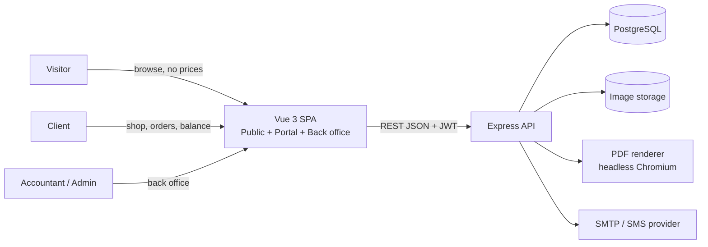
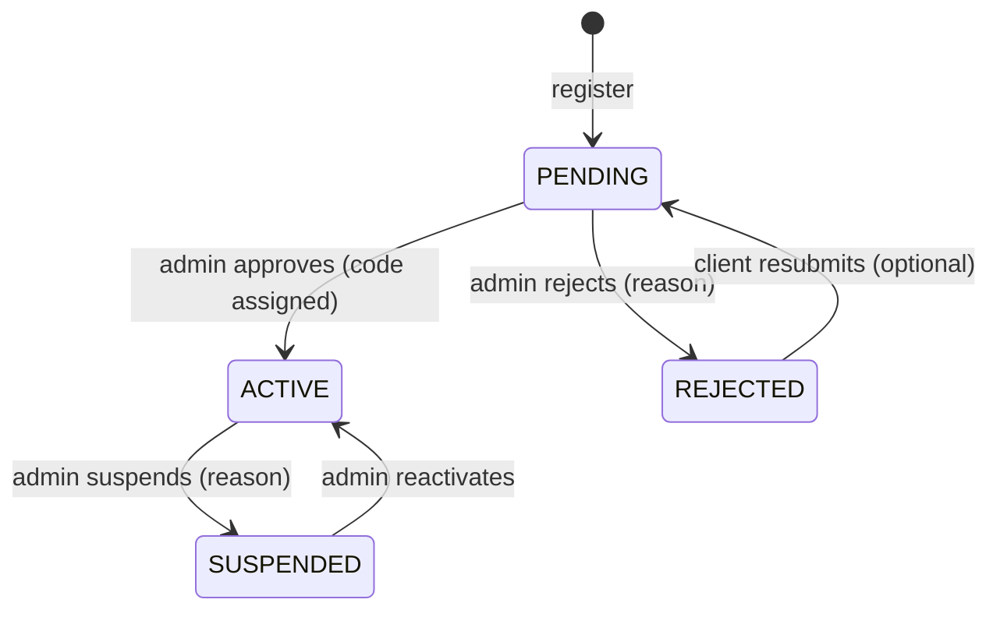
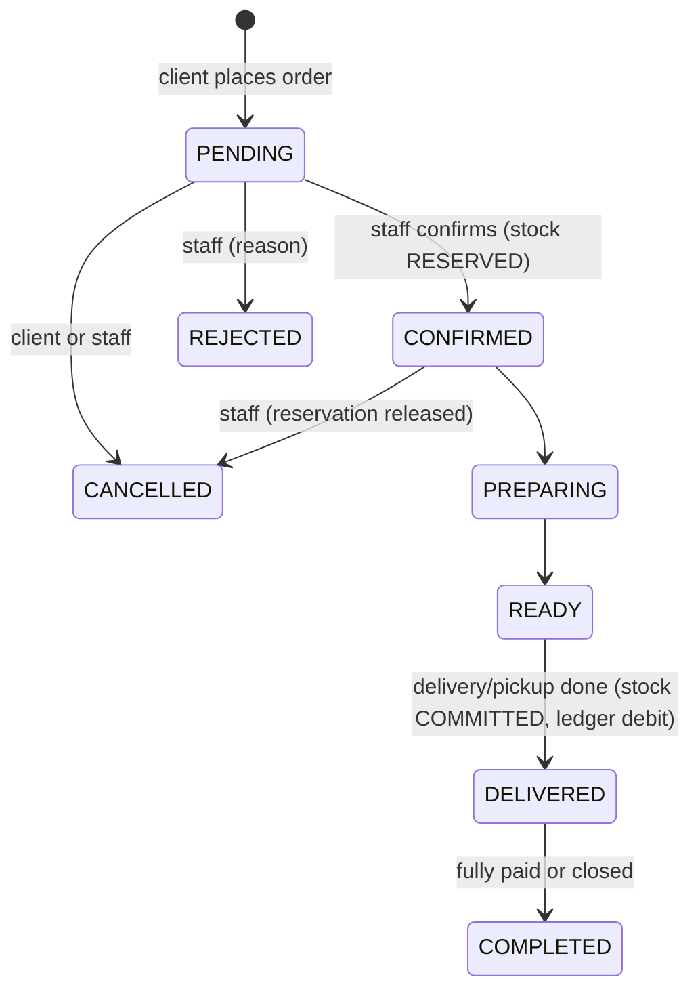

# 02 — System Design

## 1. Context



One deployable frontend, one API, one DB. Single store ⇒ **no tenant/warehouse dimension anywhere**.

## 2. Backend layering

```
routes (HTTP, validation, auth)  →  services (business rules, transactions)  →  repositories/SQL (pg)
                    ↓                              ↓
             middleware                  audit + notification dispatch
```

- **Routes** never contain business logic; they validate input (zod), call a service, wrap the response.
- **Services** own transactions: `withTransaction(async (tx) => ...)`. One service function = one atomic business operation.
- **Repositories** are plain parameterized SQL (`pg`), no ORM (kept from old project).
- Money = `NUMERIC(14,2)`; parsed to JS number via `pg.types.setTypeParser(1700, parseFloat)` (as in old `database.ts`). For rounding use a helper `round2()`; compute totals line-by-line then sum.

### Services (modules)
| Service | Responsibility |
| :--- | :--- |
| `auth.service` | register, login, email verify, password reset, JWT |
| `client.service` | profile, approval workflow, credit limit |
| `catalog.service` | products, categories, images, publish flag, import/export |
| `serializer` | **the only place** deciding which product/price fields leave the API |
| `stock.service` | reserve / release / commit / adjust / purchase receipt (all `FOR UPDATE`) |
| `cart.service` | cart CRUD, validation |
| `order.service` | place, status machine, edit, cancel |
| `ledger.service` | append-only ledger, payments, credit/refund |
| `facture.service` | numbering, timbre, totals, void |
| `report.service` | dashboard, P&L, valuation, receivables |
| `hr.service` | employees, payroll generation |
| `notification.service`, `audit.service` | cross-cutting |
| `pdf.service` | render document routes to PDF |
| `numbering.service` | gap-free yearly sequences (table `sequences`, `UPDATE ... RETURNING`) |

## 3. Client account state machine


Only `ACTIVE` ⇒ prices + cart + orders. Guard: `requireActiveClient` middleware re-reads status from DB (not from the JWT) so suspension is immediate.

## 4. Order state machine


Allowed transitions are a constant map in `order.service`; every transition writes `order_status_history` and a notification.

**Stock effect per transition**
| Transition | physical | reserved | movement |
| :--- | :---: | :---: | :--- |
| → CONFIRMED | – | +qty | RESERVATION |
| CONFIRMED/PREPARING/READY → CANCELLED | – | −qty | RELEASE |
| READY → DELIVERED | −qty | −qty | SALE |
| Return after delivery | +qty | – | RETURN (+ credit note) |

**Ledger effect:** at `DELIVERED`, post `INVOICE` debit = total_ttc (unless paid in cash at hand-over, then debit + immediate `PAYMENT` credit). **[ASSUMPTION]** ledger is posted on delivery, not on placement.

## 5. Critical flow — place order (pseudo)

```
POST /orders (client)
 1. requireActiveClient
 2. BEGIN
 3. load cart_items JOIN products (active, published)
 4. re-price from DB (sale_price, tva); ignore anything from the client
 5. if payment=ON_CREDIT and (balance + total) > credit_limit → 422 CREDIT_LIMIT_EXCEEDED
 6. next order_number (sequence)
 7. INSERT orders, order_items (snapshot name/ref/price/tva/purchase_price)
 8. INSERT order_status_history(PENDING), clear cart
 9. COMMIT; notify staff; audit
```
Stock is checked for availability at placement (soft check, no reservation) and **reserved at confirmation** under `FOR UPDATE`; if insufficient, confirmation fails with the shortfall list so staff can edit quantities or reject. **[ASSUMPTION]**

## 6. Concurrency & integrity rules
1. Every stock mutation: `BEGIN; SELECT ... FROM stock WHERE product_id = ANY($1) ORDER BY product_id FOR UPDATE;` (sorted lock order prevents deadlocks).
2. `CHECK (physical >= 0 AND reserved >= 0 AND reserved <= physical)`.
3. `stock_movements`, `client_transactions`, `audit_logs`, `order_status_history` are **append-only** (revoke UPDATE/DELETE from the app DB role; optional trigger raising an exception).
4. `clients.current_balance` is a cache of the last ledger `running_balance`; ledger rows per client are serialized with `SELECT ... FROM clients WHERE id=$1 FOR UPDATE`.
5. Sequences (order/facture/payment numbers) come from a `sequences` table, never `MAX()+1`.

## 7. Frontend architecture

```
src/
  main.ts, App.vue
  router/            guards: public | requiresAuth | requiresActiveClient | requiresStaff | requiresAdmin
  layouts/           PublicLayout, AuthLayout, PortalLayout (client), BackOfficeLayout (staff)
  views/public|portal|admin/
  components/common  (AppButton, AppInput, AppTable, AppModal, AppBadge, AppPagination, AppSkeleton, ConfirmDialog, AppProductCombobox, AppClientCombobox — reuse)
  components/documents  (FactureDocument, DeliveryNoteDocument, StatementDocument, ReceiptDocument, PriceListDocument)
  stores/            auth, cart, shop, order, client, notification, ui
  services/          one axios adapter per API area
  i18n/              fr.json, ar.json (vue-i18n); dir switches rtl/ltr
  assets/styles/     variables.css, main.css, print.css
```
- Auth store holds `{user, clientStatus}`; after login/refresh call `/auth/me` (status can change).
- Public pages call `/public/*`; the product DTO has no price keys, so the UI can't leak them.
- Router: unauthenticated user hitting `/shop` → `/login?redirect=`; PENDING client → `/account/pending`.

## 8. Cross-cutting conventions
- **Response envelope:** `{ success: true, data, meta? }` / `{ success: false, error: { code, message, details? } }` (extend old `response.ts` with machine-readable `code`).
- **Pagination:** `?page=1&pageSize=25` → `meta: { page, pageSize, total }`.
- **Dates:** stored `TIMESTAMPTZ` UTC; display in `Africa/Algiers`. Business dates (`expense_date`, `period`) are `DATE`.
- **Validation:** zod schemas shared by route and tests.
- **Logging:** pino, request id, no PII/password in logs.
- **Files:** product images resized server-side (sharp) to `thumb 320`, `medium 800`, `large 1600` WebP; stored on disk behind `/media` or in S3-compatible storage (interface `StorageProvider`).
- **Search:** `pg_trgm` on product name/reference and client name/phone.
- **Emails:** templates for verify email, account approved/rejected, order status, statement. Provider behind `Mailer` interface (SMTP first). SMS/WhatsApp = later adapter.
- **Background jobs (light):** `node-cron` in-process: low-stock digest, stale PENDING order reminder, unverified-account cleanup.

## 9. Deployment
- Docker compose: `api`, `web` (nginx serving Vite build, proxies `/api` and `/media`), `db`, optional `chromium` sidecar for PDF.
- Env-driven config (see [09](09-roadmap-and-setup.md)); migrations run on boot via a tiny runner (`db/migrations/NNN_name.sql`, `schema_migrations` table). Replace the old "DDL in schema.ts on every boot" pattern.
- Daily `pg_dump` backup + media folder backup; restore tested.
- HTTPS (Caddy/nginx + Let's Encrypt), HSTS, `trust proxy` set for rate-limit and IP audit.

