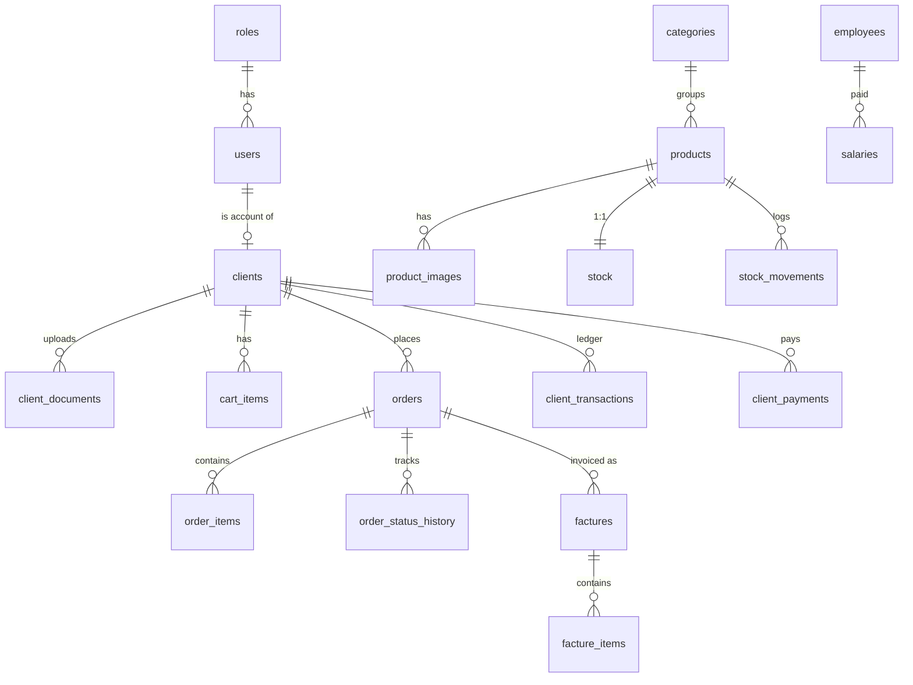

# 03 — Database Design

Full executable DDL: [schema.sql](schema.sql). PostgreSQL 15+, extensions `pg_trgm`, `citext`.

## 1. ER overview



## 2. Changes vs. the old schema
| Old | New |
| :--- | :--- |
| `warehouses`, `transfers*`, `sale_fulfillment_lines`, `stock_reservations` | removed |
| `warehouse_id` on users/stock/movements/ledger/expenses/employees/audit | removed |
| `users.username` | `users.email` (CITEXT, login) |
| `clients` created by staff only | + `user_id`, `status`, approval fields, `credit_limit` |
| `sales` / `sale_items` | `orders` / `order_items` (+ `order_status_history`) |
| `stock(warehouse_id, product_id)` | `stock(product_id)` |
| `products.category` (dropped in old repo) | `categories` table + `products.category_id` (needed for the shop) |
| – | `cart_items`, `product_images`, `sequences`, `settings`, `suppliers/purchases`, `client_documents`, `email_tokens` |

## 3. Business invariants (enforce in DB where possible)
1. `stock.physical_quantity >= 0`, `reserved_quantity >= 0`, `reserved <= physical`.
2. Ledger: `debit >= 0`, `credit >= 0`, never both > 0 on one row; `running_balance = prev + debit − credit`; append-only.
3. `order_items.unit_price`, `tva`, `purchase_price_snapshot`, name & reference are **snapshots** — never recomputed from `products`.
4. A client with `status <> 'ACTIVE'` cannot own orders created after the change (enforced in service; history preserved).
5. `clients.code` is unique and assigned only on approval (`CLT-0001`…); walk-in default client `CLT-COMPTOIR` has `is_default = true`, `status = 'ACTIVE'`.
6. `factures` immutable except void fields; void requires reason.
7. One non-voided `FACTURE` per order (partial unique index).

## 4. Numbering (gap-free, yearly reset)
`sequences(key, year, last_value)`; `next_number('FAC', 2026)` → `FAC-2026-0001`.
Keys: `CMD` (orders), `FAC` (factures), `BL` (delivery notes), `PRO` (proforma), `PAY` (payments), `AVO` (credit notes), `CLT` (clients, no year).
```sql
INSERT INTO sequences(key, year, last_value) VALUES ($1,$2,1)
ON CONFLICT (key, year) DO UPDATE SET last_value = sequences.last_value + 1
RETURNING last_value;
```
Called inside the business transaction so a rollback doesn't burn a number.

## 5. Ledger recipes (inside one transaction, client row locked)
| Event | type | debit | credit | Side effects |
| :--- | :--- | :---: | :---: | :--- |
| Delivery of order on credit | INVOICE | total_ttc | 0 | – |
| Cash at hand-over | INVOICE + PAYMENT | total / 0 | 0 / total | `client_payments` row |
| Payment (versement) | PAYMENT | 0 | amount | allocate to orders (oldest first or chosen) |
| Return / discount | CREDIT_NOTE | 0 | amount | `AVO-` number, stock RETURN |
| Refund of advance | REFUND | amount | 0 | only if balance < 0 |
| Opening balance import | ADJUSTMENT | ± | ± | admin only, audited |

Sign convention: **positive balance = client owes the store**.
Order payment status derived: `PAID` if allocated ≥ total, `PARTIAL`, `UNPAID` (`payment_allocations` table).

## 6. Timbre fiscal rule (in `settings`, editable)
`timbre = clamp(round(total_ttc * 0.01), 5, 10000)` when payment mode = `CASH`, else 0. Rate/min/max stored as settings because legislation changes. **[VERIFY with accountant — the old spec cites 1%, min 5, max 10 000 DZD; real Algerian stamp duty is graduated by bracket, so confirm the current bracket table before go-live.]**

## 7. Visibility columns
| Column | Visitor/Pending | Active client | Accountant | Admin |
| :--- | :---: | :---: | :---: | :---: |
| `products.sale_price`, `facture_price`, `tva` | ✗ | ✓ | ✓ | ✓ |
| `products.purchase_price`, `order_items.purchase_price_snapshot` | ✗ | ✗ | ✗ | ✓ |
| `stock.physical/reserved` | ✗ (badge only) | ✗ (badge only) | ✓ | ✓ |

## 8. Indexing
See bottom of schema.sql. Rules: index every FK, `(client_id, created_at DESC)` on orders/ledger, `status` partial indexes for queues (`clients WHERE status='PENDING'`, `orders WHERE status IN (...)`), trigram on search fields.

## 9. Seed (dev)
- roles: ADMIN, ACCOUNTANT, CLIENT
- 1 admin (`admin@store.local`, forced password change), 1 accountant
- walk-in client `CLT-COMPTOIR`
- 5 categories, 30 sample products with images, stock rows
- settings: company legal identity (RC, NIF, NIS, ART, address, logo), TVA default 19, timbre rule, order/facture prefixes

## 10. Migrations
Plain SQL files in `backend/src/db/migrations/NNN_description.sql`, applied in order, tracked in `schema_migrations(version, applied_at)`. `schema.sql` = baseline `001_init.sql`. Never edit an applied migration.

